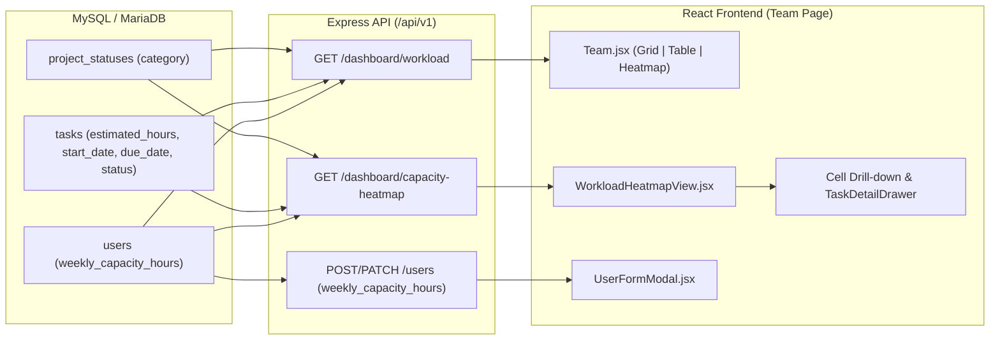

# Rencana Implementasi: Resource Capacity & Workload Heatmap di Halaman Tim

## Goal Description

Saat ini halaman **Team** ([Team.jsx](file:///c:/xampp/htdocs/project_management/frontend/src/pages/Team.jsx)) hanya menampilkan beban kerja berdasarkan jumlah task aktif (`total - done`) dari endpoint `GET /api/v1/dashboard/workload`. Pendekatan tersebut belum memperhitungkan bobot jam kerja (`estimated_hours`) maupun durasi penjadwalan task, sehingga seorang anggota dengan 2 task besar (misal total 60 jam dalam seminggu) terlihat lebih ringan dibandingkan anggota dengan 5 task kecil (total 10 jam).

Fitur **Resource Capacity & Workload Heatmap** ini menambahkan:
1. **Kapasitas Jam Kerja Mingguan per Anggota (`weekly_capacity_hours`)**: Tersimpan di tabel `users` (default `40.00` jam/minggu) dan dapat dikonfigurasi oleh Administrator melalui modal tambah/edit pengguna.
2. **Perhitungan Beban Kerja Pro-rata Mingguan**: Membagi `estimated_hours` setiap task secara proporsional berdasarkan hari kerja (Senin–Jumat) sepanjang rentang `start_date` hingga `due_date` (dengan fallback ke minggu `due_date` apabila `start_date` kosong, atau minggu `start_date` apabila `due_date` kosong).
3. **Visualisasi Workload Heatmap & Deteksi Overallocation**:
   - Mode tampilan **Heatmap** pada halaman Team yang memetakan matriks **Anggota Tim × Minggu** (4 / 8 / 12 minggu) dengan kode warna tingkat utilisasi (`Idle 0%`, `Underload <50%`, `Optimal 50–85%`, `Near Capacity 86–100%`, `Overallocated >100%`).
   - Filter proyek, navigasi rentang minggu, filter cepat anggota yang mengalami *overallocation*, serta toggle untuk menyertakan/mengecualikan task yang sudah selesai (`done`).
   - **Drill-down Drawer/Modal** saat sel minggu diklik untuk melihat rincian task penyumbang jam kerja pada minggu tersebut dan membuka [`TaskDetailDrawer`](file:///c:/xampp/htdocs/project_management/frontend/src/components/shared/TaskDetailDrawer.jsx) secara langsung guna melakukan *re-assign* atau penyesuaian jadwal.
   - Indikator kapasitas & *overallocation badge* minggu berjalan pada tampilan **Grid**, **Table**, dan **Member Detail Drawer** di halaman Team.

---

## User Review Required

> [!IMPORTANT]
> **Keputusan Desain yang Diterapkan (Berdasarkan Konfirmasi)**
> 1. **Distribusi Jam Kerja Pro-rata**: Task dengan `start_date` dan `due_date` lintas minggu akan mendistribusikan `estimated_hours` secara proporsional berdasarkan jumlah hari kerja (Senin–Jumat) yang beririsan pada masing-masing minggu. Jika seluruh durasi task jatuh di akhir pekan, perhitungan otomatis menggunakan jumlah hari kalender agar jam estimasi tidak hilang. Task tanpa `start_date` dibebankan 100% ke minggu `due_date`. Task aktif yang belum memiliki `start_date` maupun `due_date` akan dicatat pada metrik `unscheduledHours` anggota agar tetap terpantau.
> 2. **Kapasitas per Anggota di Database**: Kolom `weekly_capacity_hours DECIMAL(5,2) NOT NULL DEFAULT 40.00` ditambahkan ke tabel `users` (migrasi bersifat *idempotent* untuk instalasi baru maupun database yang sudah berjalan).
> 3. **Cakupan Status Task**: Secara default hanya menghitung task aktif (`status <> 'done'` dan kategori status proyek `<> 'done'`), disertai toggle **"Sertakan task selesai"** di toolbar Heatmap.

---

## Arsitektur & Alur Data



---

## Proposed Changes

### 1. Database Schema & Migrasi

#### [MODIFY] [schema.sql](file:///c:/xampp/htdocs/project_management/backend/src/database/schema.sql)
Menambahkan kolom `weekly_capacity_hours` pada definisi tabel `users`:
```diff
   job_title     VARCHAR(120)  NULL,
   bio           TEXT          NULL,
+  weekly_capacity_hours DECIMAL(5,2) NOT NULL DEFAULT 40.00,
   is_active     TINYINT(1)    NOT NULL DEFAULT 1,
```

#### [MODIFY] [migrate.js](file:///c:/xampp/htdocs/project_management/backend/src/database/migrate.js)
Menambahkan *patch migration* yang *idempotent* pada fungsi [`applyPatchMigrations`](file:///c:/xampp/htdocs/project_management/backend/src/database/migrate.js#L85-L258) untuk mengecek keberadaan kolom `weekly_capacity_hours` di tabel `users` melalui `information_schema.COLUMNS` dan menjalankannya bila belum ada:
```javascript
  try {
    const [userCapCol] = await connection.query(
      `SELECT COLUMN_NAME FROM information_schema.COLUMNS
        WHERE TABLE_SCHEMA = ? AND TABLE_NAME = 'users' AND COLUMN_NAME = 'weekly_capacity_hours'`,
      [env.DB_NAME]
    );
    if (!userCapCol.length) {
      await connection.query(
        `ALTER TABLE users ADD COLUMN weekly_capacity_hours DECIMAL(5,2) NOT NULL DEFAULT 40.00 AFTER bio`
      );
      console.log('[migrate] Added users.weekly_capacity_hours column.');
    }
  } catch (err) {
    console.warn('[migrate] Note on users.weekly_capacity_hours check:', err.message);
  }
```

---

### 2. Backend: Model, Validator, & Controller Pengguna

#### [MODIFY] [userModel.js](file:///c:/xampp/htdocs/project_management/backend/src/models/userModel.js)
- Menambahkan `u.weekly_capacity_hours` pada `SELECT_FIELDS` dan [`listActive`](file:///c:/xampp/htdocs/project_management/backend/src/models/userModel.js#L132-L145).
- Menambahkan normalisasi nilai `weekly_capacity_hours` menjadi `Number` (default `40`).
- Mendukung penyimpanan `weekly_capacity_hours` pada [`createUser`](file:///c:/xampp/htdocs/project_management/backend/src/models/userModel.js#L67-L86) dan [`updateUser`](file:///c:/xampp/htdocs/project_management/backend/src/models/userModel.js#L92-L110).

#### [MODIFY] [auth.js](file:///c:/xampp/htdocs/project_management/backend/src/middleware/auth.js)
- Menyertakan `weekly_capacity_hours` pada query `SELECT` di [`requireAuth`](file:///c:/xampp/htdocs/project_management/backend/src/middleware/auth.js#L37-L40) dan [`optionalAuth`](file:///c:/xampp/htdocs/project_management/backend/src/middleware/auth.js#L61-L64).

#### [MODIFY] [auth.validator.js](file:///c:/xampp/htdocs/project_management/backend/src/validators/auth.validator.js)
- Menambahkan validasi `weekly_capacity_hours` pada [`createUserSchema`](file:///c:/xampp/htdocs/project_management/backend/src/validators/auth.validator.js#L66-L74) dan [`updateUserSchema`](file:///c:/xampp/htdocs/project_management/backend/src/validators/auth.validator.js#L77-L86):
```javascript
  weekly_capacity_hours: z.coerce
    .number()
    .min(1, 'Kapasitas minimal 1 jam per minggu')
    .max(168, 'Kapasitas maksimal 168 jam per minggu')
    .optional(),
```

#### [MODIFY] [userController.js](file:///c:/xampp/htdocs/project_management/backend/src/controllers/userController.js)
- Meneruskan field `weekly_capacity_hours` saat membuat pengguna baru di [`createUser`](file:///c:/xampp/htdocs/project_management/backend/src/controllers/userController.js#L50-L78) (default `40`).

---

### 3. Backend: Mesin Kalkulasi Kapasitas & Endpoint Heatmap

#### [MODIFY] [dashboardController.js](file:///c:/xampp/htdocs/project_management/backend/src/controllers/dashboardController.js)
1. **Helper Distribusi Jam Kerja Pro-rata (`allocateTaskHoursToWeeks`)**:
   - Menerima daftar minggu `[weekStart, weekEnd]` (Senin s/d Minggu) dan daftar task.
   - Menentukan rentang tanggal efektif task:
     - Jika `start_date` dan `due_date` tersedia: `[min(start_date, due_date), max(start_date, due_date)]`.
     - Jika hanya `due_date`: `[due_date, due_date]`.
     - Jika hanya `start_date`: `[start_date, start_date]`.
     - Jika keduanya `null`: ditambahkan ke `unscheduledHours` & `unscheduledTasks` milik anggota.
   - Menghitung jumlah hari kerja (Senin–Jumat) dalam rentang efektif task (`totalWorkingDays`). Apabila task dimulai dan berakhir di akhir pekan (`totalWorkingDays === 0`), menggunakan jumlah hari kalender sebagai pembagi.
   - Untuk setiap minggu yang beririsan dengan rentang efektif task, menghitung `allocatedHours = round((estimated_hours * overlapWorkingDays) / totalWorkingDays, 2)`.
2. **Memperkaya Endpoint [`getWorkload`](file:///c:/xampp/htdocs/project_management/backend/src/controllers/dashboardController.js#L336-L372) (`GET /api/v1/dashboard/workload`)**:
   - Mengembalikan field tambahan untuk setiap anggota:
     - `weeklyCapacityHours`: kapasitas mingguan anggota (`Number(u.weekly_capacity_hours) || 40`)
     - `activeEstimatedHours`: total `estimated_hours` dari seluruh task aktif anggota
     - `currentWeekHours`: total jam teralokasi pada minggu berjalan (Senin–Minggu ini)
     - `currentWeekUtilization`: persentase utilisasi minggu berjalan (`round((currentWeekHours / weeklyCapacityHours) * 100, 1)`)
     - `isOverallocated`: boolean (`currentWeekHours > weeklyCapacityHours`)
3. **Menambahkan Handler Baru `getCapacityHeatmap` (`GET /api/v1/dashboard/capacity-heatmap`)**:
   - **Query params**:
     - `start_date` (opsional, default: Senin minggu berjalan)
     - `weeks` (opsional, `4`–`16`, default: `8`)
     - `project_id` (opsional, filter ke satu proyek yang dapat diakses)
     - `role` (opsional, filter peran user)
     - `search` (opsional, filter nama/email user)
     - `include_completed` (opsional, `'true' | '1'`, default `false`)
   - **Response Payload**:
     - `weeks`: Array metadata minggu `[{ key, label, shortLabel, startDate, endDate, isCurrentWeek }]`
     - `members`: Array data per anggota aktif (atau sesuai filter) berisi profil singkat, `weeklyCapacityHours`, `activeTaskCount`, `unscheduledHours`, `unscheduledTaskCount`, `peakUtilization`, `overallocatedWeeksCount`, `avgUtilization`, serta array `cells` per minggu:
       ```json
       {
         "weekKey": "2026-10-26",
         "allocatedHours": 46.5,
         "capacityHours": 40,
         "availableHours": 0,
         "overloadHours": 6.5,
         "utilizationPercent": 116.3,
         "status": "overallocated",
         "taskCount": 3,
         "tasks": [
           {
             "id": 12,
             "title": "Integrasi API absensi dengan modul payroll",
             "status": "in_progress",
             "priority": "urgent",
             "projectId": 2,
             "projectCode": "PRJ-2026-002",
             "projectName": "Implementasi Modul Payroll",
             "projectColor": "#ef4444",
             "startDate": "2026-10-20",
             "dueDate": "2026-11-04",
             "estimatedHours": 36,
             "allocatedHours": 15
           }
         ]
       }
       ```
     - `summary`: Ringkasan KPI tingkat tim (`totalMembers`, `overallocatedMembersCount`, `overallocatedCellsCount`, `underutilizedMembersCount`, `avgUtilizationPercent`, `totalAllocatedHours`, `totalCapacityHours`).

#### [MODIFY] [dashboard.routes.js](file:///c:/xampp/htdocs/project_management/backend/src/routes/dashboard.routes.js)
Mendaftarkan route `GET /capacity-heatmap`:
```diff
 router.get('/project-progress', asyncHandler(controller.getProjectProgress));
 router.get('/workload', asyncHandler(controller.getWorkload));
+router.get('/capacity-heatmap', asyncHandler(controller.getCapacityHeatmap));
```

---

### 4. Frontend: API Client, Form Pengguna, & Komponen Heatmap

#### [MODIFY] [index.js](file:///c:/xampp/htdocs/project_management/frontend/src/api/index.js)
Menambahkan metode `capacityHeatmap` pada `dashboardApi`:
```diff
 export const dashboardApi = {
   stats: () => api.get('/dashboard/stats').then((res) => res.data.data),
   myTasks: () => api.get('/dashboard/my-tasks').then((res) => res.data.data),
   projectProgress: () => api.get('/dashboard/project-progress').then((res) => res.data.data),
   workload: () => api.get('/dashboard/workload').then((res) => res.data.data),
+  capacityHeatmap: (params) =>
+    api.get('/dashboard/capacity-heatmap', { params }).then((res) => res.data.data),
 };
```

#### [MODIFY] [UserFormModal.jsx](file:///c:/xampp/htdocs/project_management/frontend/src/components/shared/UserFormModal.jsx)
- Menambahkan field `weekly_capacity_hours` pada skema validasi Zod (`z.coerce.number().min(1).max(168)`), `buildDefaults` (default `40`), dan payload mutasi.
- Menambahkan input angka **"Kapasitas Kerja (Jam/Minggu)"** pada form modal pengguna agar Admin dapat menyesuaikan kapasitas per anggota (mis. 40 jam untuk full-time, 20 jam untuk part-time).

#### [NEW] [WorkloadHeatmapView.jsx](file:///c:/xampp/htdocs/project_management/frontend/src/components/shared/WorkloadHeatmapView.jsx)
Komponen khusus untuk menampilkan dan menganalisis **Resource Capacity & Workload Heatmap**:
1. **KPI Summary Cards**:
   - **Rata-rata Utilisasi Tim**: Persentase rata-rata beban jam kerja dibanding kapasitas.
   - **Total Jam Teralokasi vs Kapasitas**: Total jam kerja yang dijadwalkan dalam rentang minggu terpilih.
   - **Terdeteksi Overallocation**: Jumlah anggota yang melebihi kapasitas (`>100%`) beserta jumlah minggu terjadinya *overload*.
   - **Kapasitas Tersedia (Underload)**: Jumlah anggota dengan utilisasi `<50%` yang siap menerima delegasi task baru.
2. **Kontrol & Filter Heatmap**:
   - Navigasi periode minggu (`← Sebelumnya`, `Minggu Ini`, `Berikutnya →`).
   - Pemilih jumlah minggu (`4 Minggu`, `8 Minggu`, `12 Minggu`).
   - Filter Proyek (memuat daftar proyek dari `projectApi.list`).
   - Switch/Toggle: **Sertakan task selesai** (`includeCompleted`) dan **Hanya Overallocated**.
3. **Matriks Heatmap Interaktif**:
   - Kolom anggota *sticky* di sisi kiri lengkap dengan Avatar, Nama, Jabatan, Kapasitas (`40j/mgg`), dan badge utilisasi rata-rata.
   - Sel per minggu dengan skema warna semantik:
     - `0%` (*Kosong*): `bg-slate-50 text-slate-400 dark:bg-slate-900/40`
     - `1%–49%` (*Underload*): `bg-sky-50 text-sky-700 border-sky-200 dark:bg-sky-500/10 dark:text-sky-300`
     - `50%–85%` (*Optimal*): `bg-emerald-50 text-emerald-700 border-emerald-200 dark:bg-emerald-500/10 dark:text-emerald-300`
     - `86%–100%` (*Hampir Penuh*): `bg-amber-50 text-amber-700 border-amber-200 dark:bg-amber-500/10 dark:text-amber-300`
     - `>100%` (*Overallocated*): `bg-rose-50 text-rose-700 border-rose-300 ring-1 ring-rose-500/30 dark:bg-rose-500/15 dark:text-rose-300` dengan ikon `AlertTriangle`.
   - Menampilkan jam teralokasi (`32j`), persentase (`80%`), serta bar progres visual di dalam sel.
4. **Cell Drill-down Drawer & Integrasi [`TaskDetailDrawer`](file:///c:/xampp/htdocs/project_management/frontend/src/components/shared/TaskDetailDrawer.jsx)**:
   - Klik pada sel minggu membuka drawer rincian kapasitas minggu tersebut (menampilkan selisih jam tersedia / *overload*, daftar task penyumbang jam, alokasi jam minggu tersebut vs total `estimated_hours` task, dan tombol untuk langsung membuka detail task di [`TaskDetailDrawer`](file:///c:/xampp/htdocs/project_management/frontend/src/components/shared/TaskDetailDrawer.jsx)).

#### [MODIFY] [Team.jsx](file:///c:/xampp/htdocs/project_management/frontend/src/pages/Team.jsx)
- Menambahkan tab tampilan **`Heatmap`** pada `VIEW_OPTIONS` (`Grid | Table | Heatmap`).
- Pada tampilan **Grid** dan **Table**:
  - Menampilkan indikator **Kapasitas Minggu Ini** (`currentWeekHours / weeklyCapacityHours jam` beserta persentase & badge `Overallocated` berwarna merah apabila `> 100%`) berdampingan dengan metrik `Tugas Aktif`.
- Pada **Member Detail Drawer**:
  - Menampilkan informasi kapasitas mingguan anggota (`weekly_capacity_hours` jam/minggu), bar utilisasi minggu berjalan, total estimasi jam aktif, serta tombol cepat untuk melihat anggota tersebut di tampilan Heatmap.

---

## Verification Plan

### Automated Tests
1. **Migrasi Database**:
   ```powershell
   node backend/src/database/migrate.js
   ```
   Memastikan kolom `users.weekly_capacity_hours` berhasil ditambahkan secara *idempotent* tanpa merusak data yang ada.
2. **API Smoke Test & Verifikasi Endpoint Heatmap**:
   ```powershell
   node backend/scripts/verify-api.js
   ```
   Memastikan seluruh endpoint existing dan endpoint baru `GET /api/v1/dashboard/capacity-heatmap` serta `GET /api/v1/dashboard/workload` mengembalikan status `200` dengan struktur data kapasitas dan perhitungan pro-rata yang akurat.
3. **Frontend Production Build Check**:
   ```powershell
   npm --prefix frontend run build
   ```
   Memastikan tidak ada error kompilasi JSX, import, maupun bundle Vite.

### Manual Verification
1. Buka halaman **Team** (`/team`) menggunakan browser:
   - Periksa tampilan **Grid** dan **Table**: pastikan setiap anggota menampilkan kapasitas minggu berjalan (misal `24j / 40j`) dan badge status kapasitas.
   - Beralih ke tampilan **Heatmap**: pastikan matriks anggota × minggu tampil dengan kode warna yang sesuai (Hijau/Biru/Kuning/Merah).
   - Klik salah satu sel minggu yang memiliki beban kerja / *overallocation*: pastikan drawer rincian terbuka dan menampilkan daftar task beserta perhitungan jam pro-ratanya.
   - Klik salah satu task di dalam drawer rincian untuk memastikan `TaskDetailDrawer` terbuka dengan benar.
   - Uji tombol navigasi minggu (`←`, `Minggu Ini`, `→`), filter proyek, filter `Hanya Overallocated`, dan toggle `Sertakan task selesai`.
   - Sebagai Admin, klik **Edit** pada salah satu anggota tim, ubah nilai **Kapasitas Kerja (Jam/Minggu)** (misal dari `40` menjadi `25`), simpan, dan pastikan persentase utilisasi serta deteksi *overallocation* langsung diperbarui.

