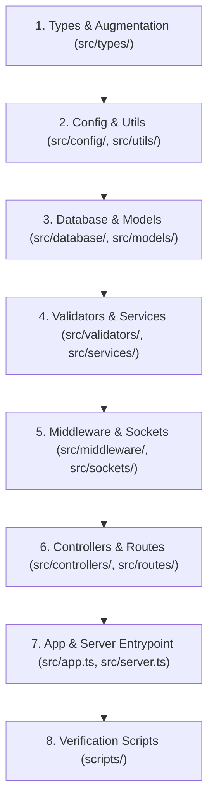

# Rencana Implementasi: Migrasi Backend ke TypeScript (`.ts`) Tanpa Mengubah Logic

## Goal Description

Memigrasikan seluruh kode backend pada direktori [`backend/`](file:///c:/xampp/htdocs/project_management/backend) (~60 file di `backend/src/` beserta script verifikasi di `backend/scripts/`) dari JavaScript CommonJS (`.js`) menjadi **TypeScript (`.ts`)** tanpa mengubah satu pun *business logic*, query SQL, struktur respons REST API, validasi Zod, maupun perilaku real-time Socket.IO.

Tujuan utama migrasi ini adalah:
1. Memberikan *type safety* dan *autocomplete* penuh di seluruh layer backend (`config`, `utils`, `database`, `models`, `validators`, `services`, `middleware`, `controllers`, `routes`, `sockets`).
2. Mempertahankan 100% kompatibilitas perilaku runtime dengan frontend yang sudah ada.
3. Menyediakan workflow development modern berbasis `tsx` (eksekusi langsung `.ts` dengan *watch mode*) serta kompilasi penuh via `tsc` (`npm run build` & `npm run typecheck`).

---

## User Review Required

> [!IMPORTANT]
> **Jaminan Zero-Logic-Change**
> - Seluruh query SQL, struktur tabel, perhitungan finansial/EVM/progress, alur autentikasi JWT, RBAC, hingga format JSON response (`sendSuccess`, `sendPaginated`, `sendError`) **dipertahankan 100% identik**.
> - Compiler TypeScript dikonfigurasi dengan `"module": "commonjs"` dan `"esModuleInterop": true` di `tsconfig.json`, sehingga modul yang dikompilasi menghasilkan perilaku CommonJS yang sama persis dengan kode `.js` saat ini.

> [!NOTE]
> **Penghapusan File `.js` Lama setelah Konversi `.ts`**
> Setiap file `.js` di dalam `backend/src/` akan digantikan oleh file `.ts` bernama sama (misalnya `src/server.js` $\rightarrow$ `src/server.ts`) dan file `.js` lama di `backend/src/` akan dihapus agar tidak terjadi duplikasi modul saat resolusi import. Hasil build JavaScript (jika menjalankan `npm run build`) akan ditempatkan terpisah di folder `backend/dist/`.

---

## Arsitektur & Urutan Migrasi Layer

Migrasi dilakukan dari layer paling bawah (tanpa dependensi internal) menuju layer terluar (entrypoint & scripts) agar setiap tahap dapat diverifikasi secara bertahap dengan `tsc --noEmit`:



---

## Proposed Changes

### 1. Tooling, Dependencies & Konfigurasi TypeScript

Menambahkan compiler TypeScript, runtime executor `tsx`, dan paket `@types/*` untuk seluruh library backend, serta menyiapkan `tsconfig.json`.

#### [MODIFY] [package.json](file:///c:/xampp/htdocs/project_management/backend/package.json)
- Menambahkan `devDependencies`:
  - `typescript`, `tsx`
  - `@types/node`, `@types/express`, `@types/cors`, `@types/compression`, `@types/morgan`, `@types/bcryptjs`, `@types/jsonwebtoken`, `@types/multer`, `@types/nodemailer`
- Memperbarui `main` dan `scripts`:
```json
{
  "main": "src/server.ts",
  "scripts": {
    "start": "tsx src/server.ts",
    "dev": "tsx watch src/server.ts",
    "build": "tsc",
    "start:prod": "node dist/server.js",
    "typecheck": "tsc --noEmit",
    "migrate": "tsx src/database/migrate.ts",
    "seed": "tsx src/database/seed.ts",
    "db:reset": "tsx src/database/migrate.ts --fresh && tsx src/database/seed.ts",
    "verify:realtime": "tsx scripts/verify-realtime.js",
    "verify:api": "tsx scripts/verify-api.js",
    "verify:collab": "tsx scripts/verify-collab-search-reminder.js"
  }
}
```

#### [NEW] [tsconfig.json](file:///c:/xampp/htdocs/project_management/backend/tsconfig.json)
```json
{
  "compilerOptions": {
    "target": "ES2022",
    "module": "commonjs",
    "lib": ["ES2022"],
    "rootDir": "./src",
    "outDir": "./dist",
    "esModuleInterop": true,
    "allowSyntheticDefaultImports": true,
    "forceConsistentCasingInFileNames": true,
    "strict": false,
    "noImplicitAny": false,
    "skipLibCheck": true,
    "resolveJsonModule": true,
    "sourceMap": true
  },
  "include": ["src/**/*"],
  "exclude": ["node_modules", "dist"]
}
```

#### [MODIFY] [.gitignore](file:///c:/xampp/htdocs/project_management/backend/.gitignore)
- Menambahkan `dist/` ke daftar ignore.

---

### 2. Definisi Tipe Global & Express Augmentation (`src/types/`)

Menyediakan deklarasi tipe untuk `req.user`, `req.token`, dan `req.validatedQuery` yang digunakan lintas middleware dan controller.

#### [NEW] [express.d.ts](file:///c:/xampp/htdocs/project_management/backend/src/types/express.d.ts)
```ts
import { AuthenticatedUser } from './index';

declare global {
  namespace Express {
    interface Request {
      user?: AuthenticatedUser;
      token?: string;
      validatedQuery?: Record<string, any>;
    }
  }
}
```

#### [NEW] [index.ts](file:///c:/xampp/htdocs/project_management/backend/src/types/index.ts)
- Mendefinisikan tipe domain utama:
  - `UserRole = 'admin' | 'manager' | 'member'`
  - `ProjectMemberRole = 'owner' | 'manager' | 'member' | 'reviewer'`
  - `AuthenticatedUser` (struktur objek `req.user` dari middleware [`requireAuth`](file:///c:/xampp/htdocs/project_management/backend/src/middleware/auth.js#L22-L58))
  - `JwtUserPayload` (`id`, `role`, `email`, `iat`, `exp`)
  - `PaginationMeta` (`page`, `perPage`, `total`, `totalPages`)

---

### 3. Layer Config & Utilities (`src/config/` & `src/utils/`)

Mengonversi seluruh file konfigurasi dan helper utilitas ke `.ts` dengan tipe parameter dan nilai kembalian yang eksplisit.

#### [NEW] `src/config/env.ts` & [DELETE] [env.js](file:///c:/xampp/htdocs/project_management/backend/src/config/env.js)
- Mendefinisikan interface `EnvConfig` untuk seluruh variabel environment (`NODE_ENV`, `PORT`, `DB_HOST`, `UPLOAD_PATH`, dll.) dan mengekspor objek `env` dengan kompatibilitas penuh.

#### [NEW] `src/config/constants.ts` & [DELETE] [constants.js](file:///c:/xampp/htdocs/project_management/backend/src/config/constants.js)
- Menambahkan tipe pada konstanta status proyek, status task, prioritas, risiko, dan fungsi [`computeRiskSeverity`](file:///c:/xampp/htdocs/project_management/backend/src/config/constants.js#L117-L130).

#### [NEW] `src/config/database.ts` & [DELETE] [database.js](file:///c:/xampp/htdocs/project_management/backend/src/config/database.js)
- Menambahkan generic dan tipe `mysql2/promise` (`Pool`, `PoolConnection`, `ResultSetHeader`) pada fungsi [`query<T = any>`](file:///c:/xampp/htdocs/project_management/backend/src/config/database.js#L26-L29), [`execute`](file:///c:/xampp/htdocs/project_management/backend/src/config/database.js#L32-L35), [`queryOne<T = any>`](file:///c:/xampp/htdocs/project_management/backend/src/config/database.js#L38-L41), [`transaction<T>`](file:///c:/xampp/htdocs/project_management/backend/src/config/database.js#L44-L57), dan [`testConnection`](file:///c:/xampp/htdocs/project_management/backend/src/config/database.js#L59-L66).

#### [NEW] `src/utils/*.ts` & [DELETE] `src/utils/*.js`
- [`ApiError.js`](file:///c:/xampp/htdocs/project_management/backend/src/utils/ApiError.js) $\rightarrow$ `ApiError.ts`: Menambahkan deklarasi properti class `statusCode: number`, `details: any`, `isOperational: boolean`.
- [`asyncHandler.js`](file:///c:/xampp/htdocs/project_management/backend/src/utils/asyncHandler.js) $\rightarrow$ `asyncHandler.ts`: Mengetik parameter handler `(req: Request, res: Response, next: NextFunction) => Promise<any> | any`.
- [`dates.js`](file:///c:/xampp/htdocs/project_management/backend/src/utils/dates.js) $\rightarrow$ `dates.ts`: Mengetik helper konversi tanggal `dayjs`.
- [`jwt.js`](file:///c:/xampp/htdocs/project_management/backend/src/utils/jwt.js) $\rightarrow$ `jwt.ts`: Mengetik `signToken`, `verifyToken` (mengembalikan `JwtUserPayload`), dan `decodeToken`.
- [`pagination.js`](file:///c:/xampp/htdocs/project_management/backend/src/utils/pagination.js) $\rightarrow$ `pagination.ts`: Mengetik `getPagination` dan `buildMeta`.
- [`password.js`](file:///c:/xampp/htdocs/project_management/backend/src/utils/password.js) $\rightarrow$ `password.ts`: Mengetik `hashPassword`, `comparePassword`, dan `validatePasswordStrength`.
- [`response.js`](file:///c:/xampp/htdocs/project_management/backend/src/utils/response.js) $\rightarrow$ `response.ts`: Mengetik `sendSuccess`, `sendPaginated`, dan `sendError` menggunakan Express `Response`.

---

### 4. Layer Database Runner & Models (`src/database/` & `src/models/`)

#### [NEW] `src/database/migrate.ts` & [DELETE] [migrate.js](file:///c:/xampp/htdocs/project_management/backend/src/database/migrate.js)
- Mempertahankan pembacaan [`schema.sql`](file:///c:/xampp/htdocs/project_management/backend/src/database/schema.sql) (dengan fallback path ke `src/database/schema.sql` jika dijalankan dari hasil build `dist/`).
- Mengekspor fungsi `runMigrate` sekaligus menjalankannya jika dipanggil langsung sebagai CLI (`require.main === module`), sehingga `seed.ts` juga dapat memanggilnya secara langsung maupun lewat subprocess.

#### [NEW] `src/database/seed.ts` & [DELETE] [seed.js](file:///c:/xampp/htdocs/project_management/backend/src/database/seed.js)
- Mengonversi seeder ke `.ts` tanpa mengubah dataset atau PRNG seed (`PRNG_SEED = 20260115`).
- Menyesuaikan eksekusi `--fresh` agar memanggil `migrate.ts` dengan lancar melalui `tsx` / fungsi migrasi langsung.

#### [NEW] `src/models/*.ts` & [DELETE] `src/models/*.js`
- [`base.js`](file:///c:/xampp/htdocs/project_management/backend/src/models/base.js) $\rightarrow$ `base.ts`
- [`userModel.js`](file:///c:/xampp/htdocs/project_management/backend/src/models/userModel.js) $\rightarrow$ `userModel.ts`
- [`projectModel.js`](file:///c:/xampp/htdocs/project_management/backend/src/models/projectModel.js) $\rightarrow$ `projectModel.ts`
- [`taskModel.js`](file:///c:/xampp/htdocs/project_management/backend/src/models/taskModel.js) $\rightarrow$ `taskModel.ts`
- [`templateModel.js`](file:///c:/xampp/htdocs/project_management/backend/src/models/templateModel.js) $\rightarrow$ `templateModel.ts`

---

### 5. Layer Validators & Services (`src/validators/` & `src/services/`)

#### [NEW] `src/validators/*.ts` & [DELETE] `src/validators/*.js`
- [`common.js`](file:///c:/xampp/htdocs/project_management/backend/src/validators/common.js) $\rightarrow$ `common.ts`
- [`auth.validator.js`](file:///c:/xampp/htdocs/project_management/backend/src/validators/auth.validator.js) $\rightarrow$ `auth.validator.ts`
- [`project.validator.js`](file:///c:/xampp/htdocs/project_management/backend/src/validators/project.validator.js) $\rightarrow$ `project.validator.ts`
- [`task.validator.js`](file:///c:/xampp/htdocs/project_management/backend/src/validators/task.validator.js) $\rightarrow$ `task.validator.ts`
- [`template.validator.js`](file:///c:/xampp/htdocs/project_management/backend/src/validators/template.validator.js) $\rightarrow$ `template.validator.ts`
- [`analytics.validator.js`](file:///c:/xampp/htdocs/project_management/backend/src/validators/analytics.validator.js) $\rightarrow$ `analytics.validator.ts`

#### [NEW] `src/services/*.ts` & [DELETE] `src/services/*.js`
- [`socketService.js`](file:///c:/xampp/htdocs/project_management/backend/src/services/socketService.js) $\rightarrow$ `socketService.ts`
- [`accessService.js`](file:///c:/xampp/htdocs/project_management/backend/src/services/accessService.js) $\rightarrow$ `accessService.ts`
- [`activityService.js`](file:///c:/xampp/htdocs/project_management/backend/src/services/activityService.js) $\rightarrow$ `activityService.ts`
- [`emailService.js`](file:///c:/xampp/htdocs/project_management/backend/src/services/emailService.js) $\rightarrow$ `emailService.ts`
- [`notificationService.js`](file:///c:/xampp/htdocs/project_management/backend/src/services/notificationService.js) $\rightarrow$ `notificationService.ts`
- [`progressService.js`](file:///c:/xampp/htdocs/project_management/backend/src/services/progressService.js) $\rightarrow$ `progressService.ts`
- [`reminderService.js`](file:///c:/xampp/htdocs/project_management/backend/src/services/reminderService.js) $\rightarrow$ `reminderService.ts`

---

### 6. Layer Middleware, Sockets, Controllers, Routes & Entrypoint

#### [NEW] `src/middleware/*.ts` & [DELETE] `src/middleware/*.js`
- [`auth.js`](file:///c:/xampp/htdocs/project_management/backend/src/middleware/auth.js) $\rightarrow$ `auth.ts`
- [`errorHandler.js`](file:///c:/xampp/htdocs/project_management/backend/src/middleware/errorHandler.js) $\rightarrow$ `errorHandler.ts`
- [`rateLimit.js`](file:///c:/xampp/htdocs/project_management/backend/src/middleware/rateLimit.js) $\rightarrow$ `rateLimit.ts`
- [`upload.js`](file:///c:/xampp/htdocs/project_management/backend/src/middleware/upload.js) $\rightarrow$ `upload.ts`
- [`validate.js`](file:///c:/xampp/htdocs/project_management/backend/src/middleware/validate.js) $\rightarrow$ `validate.ts`

#### [NEW] `src/sockets/index.ts` & [DELETE] [sockets/index.js](file:///c:/xampp/htdocs/project_management/backend/src/sockets/index.js)
- Mengetik instance `Server` dari `socket.io` dan `http.Server` beserta `socket.data`.

#### [NEW] `src/controllers/*.ts` & [DELETE] `src/controllers/*.js`
Mengonversi seluruh 13 controller:
- [`activityController.js`](file:///c:/xampp/htdocs/project_management/backend/src/controllers/activityController.js) $\rightarrow$ `activityController.ts`
- [`authController.js`](file:///c:/xampp/htdocs/project_management/backend/src/controllers/authController.js) $\rightarrow$ `authController.ts`
- [`calendarController.js`](file:///c:/xampp/htdocs/project_management/backend/src/controllers/calendarController.js) $\rightarrow$ `calendarController.ts`
- [`dashboardController.js`](file:///c:/xampp/htdocs/project_management/backend/src/controllers/dashboardController.js) $\rightarrow$ `dashboardController.ts`
- [`labelController.js`](file:///c:/xampp/htdocs/project_management/backend/src/controllers/labelController.js) $\rightarrow$ `labelController.ts`
- [`milestoneController.js`](file:///c:/xampp/htdocs/project_management/backend/src/controllers/milestoneController.js) $\rightarrow$ `milestoneController.ts`
- [`notificationController.js`](file:///c:/xampp/htdocs/project_management/backend/src/controllers/notificationController.js) $\rightarrow$ `notificationController.ts`
- [`projectController.js`](file:///c:/xampp/htdocs/project_management/backend/src/controllers/projectController.js) $\rightarrow$ `projectController.ts`
- [`reportController.js`](file:///c:/xampp/htdocs/project_management/backend/src/controllers/reportController.js) $\rightarrow$ `reportController.ts`
- [`searchController.js`](file:///c:/xampp/htdocs/project_management/backend/src/controllers/searchController.js) $\rightarrow$ `searchController.ts`
- [`taskController.js`](file:///c:/xampp/htdocs/project_management/backend/src/controllers/taskController.js) $\rightarrow$ `taskController.ts`
- [`templateController.js`](file:///c:/xampp/htdocs/project_management/backend/src/controllers/templateController.js) $\rightarrow$ `templateController.ts`
- [`userController.js`](file:///c:/xampp/htdocs/project_management/backend/src/controllers/userController.js) $\rightarrow$ `userController.ts`

#### [NEW] `src/routes/*.ts` & [DELETE] `src/routes/*.js`
Mengonversi seluruh 14 file route di `src/routes/`:
- `index.ts`, `activity.routes.ts`, `auth.routes.ts`, `calendar.routes.ts`, `dashboard.routes.ts`, `label.routes.ts`, `milestone.routes.ts`, `notification.routes.ts`, `project.routes.ts`, `report.routes.ts`, `search.routes.ts`, `task.routes.ts`, `template.routes.ts`, `user.routes.ts`.

#### [NEW] `src/app.ts` & `src/server.ts` & [DELETE] [app.js](file:///c:/xampp/htdocs/project_management/backend/src/app.js), [server.js](file:///c:/xampp/htdocs/project_management/backend/src/server.js)
- Mengonversi konfigurasi Express `app.ts` dan HTTP/Socket.IO bootstrap `server.ts`.

---

## Verification Plan

### Automated Tests
Setelah konversi selesai, kita akan menjalankan rangkaian pengujian otomatis berikut di direktori `backend`:

1. **TypeScript Static Type Check & Build**:
   ```powershell
   npm run typecheck
   npm run build
   ```
   Memastikan `tsc --noEmit` dan `tsc` selesai dengan **0 error**.

2. **Database Migration Verification**:
   ```powershell
   npm run migrate
   ```
   Memastikan `src/database/migrate.ts` berjalan lancar terhadap database MySQL.

3. **In-Process & End-to-End Verification Scripts**:
   Menjalankan seluruh suite verifikasi yang ada menggunakan `npx tsx`:
   ```powershell
   npm run verify:collab
   npx tsx scripts/test-cost-and-gantt.js
   npx tsx scripts/verify-documents.js
   npx tsx scripts/verify-risk-register-api.js
   npm run verify:api
   npm run verify:realtime
   ```

### Manual Verification
1. Menjalankan backend dengan `npm run dev` (`tsx watch src/server.ts`) dan memastikan server start di port `5000` tanpa error.
2. Membuka aplikasi frontend dan mencoba alur utama (login, melihat dashboard, membuka detail proyek, memindahkan task di Kanban board) untuk memastikan semuanya tetap berfungsi normal.

