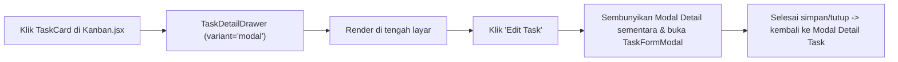

# Menampilkan Detail Task sebagai Modal Pop-up di Tengah Layar pada Halaman Kanban

## Goal Description
Saat ini, ketika pengguna mengklik kartu task pada halaman **Kanban Board** ([`Kanban.jsx`](file:///c:/xampp/htdocs/project_management/frontend/src/pages/tasks/Kanban.jsx)), detail task ditampilkan menggunakan komponen [`TaskDetailDrawer`](file:///c:/xampp/htdocs/project_management/frontend/src/components/shared/TaskDetailDrawer.jsx) yang muncul sebagai panel geser (*slide-over drawer*) di sisi kanan layar.

Perubahan ini bertujuan untuk menampilkan detail task pada halaman Kanban tepat **di tengah layar sebagai modal pop-up** menggunakan komponen [`Modal`](file:///c:/xampp/htdocs/project_management/frontend/src/components/ui/Modal.jsx) yang sudah tersedia di sistem desain aplikasi.

---

## User Review Required

> [!NOTE]
> Komponen [`TaskDetailDrawer.jsx`](file:///c:/xampp/htdocs/project_management/frontend/src/components/shared/TaskDetailDrawer.jsx) juga digunakan di beberapa halaman lain (seperti daftar Task, Gantt, Project Detail, dan Workload Heatmap). Rencana ini menambahkan prop `variant` (`'drawer' | 'modal'`) pada `TaskDetailDrawer` dan mengaktifkan `variant="modal"` pada halaman **Kanban** sesuai permintaan. Apabila Anda ingin halaman lain (misalnya halaman daftar Task atau Gantt) juga ikut menggunakan modal di tengah layar, beri tahu saya agar saya aktifkan untuk semua halaman sekaligus.

---

## Alur Perubahan



---

## Proposed Changes

### Shared Task Detail Component

#### [MODIFY] [TaskDetailDrawer.jsx](file:///c:/xampp/htdocs/project_management/frontend/src/components/shared/TaskDetailDrawer.jsx)
- Mengimpor [`Modal`](file:///c:/xampp/htdocs/project_management/frontend/src/components/ui/Modal.jsx#L18-L95) bersama `Drawer` dari [`../ui/Modal`](file:///c:/xampp/htdocs/project_management/frontend/src/components/ui/Modal.jsx).
- Menambahkan prop `variant = 'drawer'` (`'drawer' | 'modal'`) pada [`TaskDetailDrawer`](file:///c:/xampp/htdocs/project_management/frontend/src/components/shared/TaskDetailDrawer.jsx#L78).
- Jika `variant === 'modal'`, membungkus konten detail task menggunakan komponen `<Modal size="lg" ...>` (`max-w-2xl`, terpusat di tengah layar dengan efek `animate-scale-in` dan area konten `max-h-[70vh] overflow-y-auto`). Jika `variant === 'drawer'`, tetap menggunakan `<Drawer width="max-w-2xl" ...>`.

```diff
-import { Drawer } from '../ui/Modal';
+import { Drawer, Modal } from '../ui/Modal';
```

```diff
-export function TaskDetailDrawer({ taskId, open, onClose, onEdit }) {
+export function TaskDetailDrawer({ taskId, open, onClose, onEdit, variant = 'drawer' }) {
```

```diff
+  const Container = variant === 'modal' ? Modal : Drawer;
+  const containerProps =
+    variant === 'modal' ? { size: 'lg' } : { width: 'max-w-2xl' };
+
   return (
     <>
-      <Drawer
+      <Container
         open={open}
         onClose={onClose}
-        width="max-w-2xl"
+        {...containerProps}
         title={task?.title || 'Detail Task'}
         description={project ? `${project.code} - ${project.name}` : undefined}
         footer={
           ...
         }
       >
         ...
-      </Drawer>
+      </Container>
```

---

### Kanban Board Page

#### [MODIFY] [Kanban.jsx](file:///c:/xampp/htdocs/project_management/frontend/src/pages/tasks/Kanban.jsx)
- Mengirimkan prop `variant="modal"` ke [`TaskDetailDrawer`](file:///c:/xampp/htdocs/project_management/frontend/src/pages/tasks/Kanban.jsx#L474-L482).
- Mengatur `open={Boolean(detailTaskId) && !formOpen}` pada `TaskDetailDrawer` agar ketika pengguna menekan tombol **Edit Task** di dalam modal detail, modal detail tidak bertumpuk ganda di belakang [`TaskFormModal`](file:///c:/xampp/htdocs/project_management/frontend/src/components/shared/TaskFormModal.jsx) (serta mencegah tombol `Escape` menutup kedua modal sekaligus), lalu otomatis tampil kembali setelah form edit ditutup.

```diff
-      {/* --- Drawer + modal --- */}
+      {/* --- Modals --- */}
       <TaskDetailDrawer
-        open={Boolean(detailTaskId)}
+        open={Boolean(detailTaskId) && !formOpen}
+        variant="modal"
         taskId={detailTaskId}
         onClose={() => setDetailTaskId(null)}
         onEdit={(task) => {
           setEditingTask(task);
           setFormOpen(true);
         }}
       />
```

---

## Verification Plan

### Automated / Build Checks
- Menjalankan build frontend untuk memastikan tidak ada masalah sintaks atau *import*:
  ```powershell
  npm --prefix frontend run build
  ```

### Manual Verification
1. Buka halaman **Kanban Board** (`/kanban`).
2. Klik salah satu kartu task pada kolom Kanban.
3. Pastikan detail task muncul sebagai **modal pop-up di tengah layar** (bukan *drawer* di sisi kanan).
4. Uji fitur di dalam modal detail task:
   - Scroll konten detail task, tambah/centang item checklist, tambah komentar, dan lihat dependensi/lampiran.
   - Klik tombol **Edit Task** dan pastikan `TaskFormModal` tampil rapi tanpa tumpukan *backdrop* ganda, lalu simpan perubahan dan pastikan modal detail menampilkan data terbaru.
   - Tutup modal menggunakan tombol `X`, klik *backdrop* di luar modal, atau tekan tombol `Escape`.

