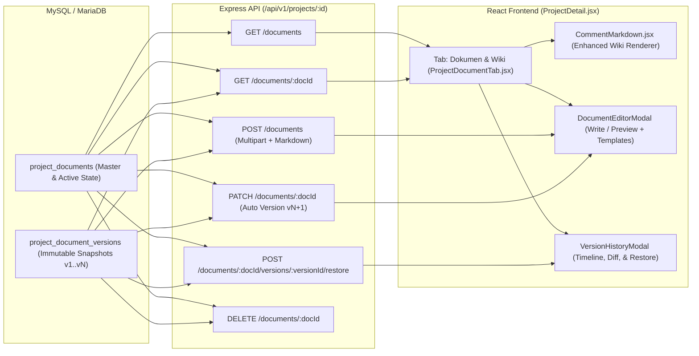

# Rencana Implementasi: Manajemen Dokumen, Wiki Proyek, & Versioning (`project_documents`)

## Goal Description

Saat ini sistem hanya mendukung lampiran file di tingkat task (`task_attachments`) dan belum memiliki repositori dokumen maupun basis pengetahuan (*knowledge base* / *wiki*) di tingkat proyek. Akibatnya, dokumen krusial lintas proyek seperti **Project Charter**, **Kontrak / MoU**, **Notulensi Rapat (MOM)**, **SOP**, dan **Spesifikasi Teknis** tidak memiliki tempat penyimpanan terpusat maupun jejak revisi (*version history*).

Fitur **Manajemen Dokumen, Wiki Proyek, & Versioning (`project_documents`)** ini menambahkan:
1. **Penyimpanan Dokumen Hybrid (Wiki Markdown + Lampiran File Fisik)**:
   - Setiap dokumen proyek dapat berisi konten artikel/catatan terstruktur menggunakan **Markdown** (dirender melalui [`CommentMarkdown.jsx`](file:///c:/xampp/htdocs/project_management/frontend/src/components/shared/CommentMarkdown.jsx)), **lampiran file fisik** (PDF, DOCX, XLSX, Gambar, ZIP, CSV, TXT), atau kombinasi keduanya dalam satu entitas dokumen (`DOC-001`, `DOC-002`, dst.).
2. **Sistem Riwayat Versi Otomatis (`project_document_versions`)**:
   - Setiap kali isi Markdown atau file lampiran dokumen diperbarui, sistem secara otomatis membuat *snapshot* versi baru (`v1`, `v2`, `v3`, ...) beserta catatan revisi (`change_note`), pengubah, dan waktu perubahan.
   - Mendukung **Lihat Isi Versi Lama (Preview)**, **Bandingkan dengan Versi Aktif**, **Unduh File Versi Lama**, serta **Restore (Kembalikan ke Versi Terpilih)** yang menciptakan versi baru dari *snapshot* terpilih agar jejak audit tetap utuh (*immutable*).
3. **Kolaborasi Tim, Penguncian Dokumen Resmi (`Lock`), & Penyematan (`Pin`)**:
   - Seluruh anggota proyek dapat membuat dan memperbarui dokumen/wiki, dilengkapi dukungan `@mention` anggota proyek di dalam isi dokumen.
   - Manajer Proyek / Owner / Admin dapat menyematkan dokumen penting (**Pin**) ke urutan teratas dan mengunci dokumen resmi (**Lock / Final**) seperti *Project Charter* atau *Kontrak/MoU* agar hanya pengelola proyek yang dapat mengubahnya.

---

## User Review Required

> [!IMPORTANT]
> **Keputusan Desain yang Diterapkan (Berdasarkan Konfirmasi)**
> 1. **Model Penyimpanan Hybrid**: Tabel `project_documents` menyimpan metadata, konten Markdown aktif (`content`), dan referensi file lampiran aktif (`file_name`, `file_original_name`, `file_mime_type`, `file_size`, `current_version`).
> 2. **Snapshot Versi & Retensi File (`project_document_versions`)**: Setiap revisi konten atau penggantian file akan menyimpan baris baru di `project_document_versions`. File fisik dari versi terdahulu tetap dipertahankan di disk selama dokumen induk belum dihapus, sehingga pengguna dapat mengunduh file versi lama maupun melakukan *Restore* kapan saja.
> 3. **Hak Akses & Kunci Dokumen (`is_locked`)**: Semua anggota proyek (`canViewProject`) dapat membuat dan mengedit dokumen yang tidak dikunci. Dokumen yang berstatus `is_locked = 1` (atau kategori resmi yang dikunci Manajer/Admin) hanya dapat diedit, dibuka kuncinya, atau dihapus oleh Manajer Proyek, Owner, atau Administrator (`canManageProject`).

---

## Arsitektur & Alur Data



---

## Proposed Changes

### 1. Database Schema & Migrasi

#### [MODIFY] [schema.sql](file:///c:/xampp/htdocs/project_management/backend/src/database/schema.sql)
Menambahkan tabel `project_documents` dan `project_document_versions`:
```sql
-- ---------------------------------------------------------------------------
-- project_documents (Project-level Documents & Wiki master records)
-- ---------------------------------------------------------------------------
CREATE TABLE IF NOT EXISTS project_documents (
  id                 INT UNSIGNED NOT NULL AUTO_INCREMENT,
  project_id         INT UNSIGNED NOT NULL,
  code               VARCHAR(30)  NOT NULL,
  title              VARCHAR(200) NOT NULL,
  category           ENUM('charter','contract','mom','sop','technical','wiki','other') NOT NULL DEFAULT 'wiki',
  status             ENUM('draft','review','published','final','archived') NOT NULL DEFAULT 'published',
  summary            VARCHAR(500) NULL,
  content            LONGTEXT     NULL,
  file_name          VARCHAR(255) NULL,
  file_original_name VARCHAR(255) NULL,
  file_mime_type     VARCHAR(120) NULL,
  file_size          INT UNSIGNED NULL,
  current_version    INT UNSIGNED NOT NULL DEFAULT 1,
  is_pinned          TINYINT(1)   NOT NULL DEFAULT 0,
  is_locked          TINYINT(1)   NOT NULL DEFAULT 0,
  created_by         INT UNSIGNED NULL,
  updated_by         INT UNSIGNED NULL,
  created_at         DATETIME     NOT NULL DEFAULT CURRENT_TIMESTAMP,
  updated_at         DATETIME     NOT NULL DEFAULT CURRENT_TIMESTAMP ON UPDATE CURRENT_TIMESTAMP,
  PRIMARY KEY (id),
  UNIQUE KEY uq_pd_project_code (project_id, code),
  KEY idx_pd_project_cat (project_id, category),
  KEY idx_pd_project_status (project_id, status),
  KEY idx_pd_project_pinned (project_id, is_pinned),
  CONSTRAINT fk_pd_project FOREIGN KEY (project_id) REFERENCES projects (id) ON DELETE CASCADE,
  CONSTRAINT fk_pd_creator FOREIGN KEY (created_by) REFERENCES users (id) ON DELETE SET NULL,
  CONSTRAINT fk_pd_updater FOREIGN KEY (updated_by) REFERENCES users (id) ON DELETE SET NULL
) ENGINE=InnoDB DEFAULT CHARSET=utf8mb4 COLLATE=utf8mb4_unicode_ci;

-- ---------------------------------------------------------------------------
-- project_document_versions (Version history snapshots for project_documents)
-- ---------------------------------------------------------------------------
CREATE TABLE IF NOT EXISTS project_document_versions (
  id                 INT UNSIGNED NOT NULL AUTO_INCREMENT,
  document_id        INT UNSIGNED NOT NULL,
  project_id         INT UNSIGNED NOT NULL,
  version_number     INT UNSIGNED NOT NULL DEFAULT 1,
  title              VARCHAR(200) NOT NULL,
  content            LONGTEXT     NULL,
  file_name          VARCHAR(255) NULL,
  file_original_name VARCHAR(255) NULL,
  file_mime_type     VARCHAR(120) NULL,
  file_size          INT UNSIGNED NULL,
  change_note        VARCHAR(500) NULL,
  created_by         INT UNSIGNED NULL,
  created_at         DATETIME     NOT NULL DEFAULT CURRENT_TIMESTAMP,
  PRIMARY KEY (id),
  UNIQUE KEY uq_pdv_doc_version (document_id, version_number),
  KEY idx_pdv_project (project_id),
  CONSTRAINT fk_pdv_document FOREIGN KEY (document_id) REFERENCES project_documents (id) ON DELETE CASCADE,
  CONSTRAINT fk_pdv_project FOREIGN KEY (project_id) REFERENCES projects (id) ON DELETE CASCADE,
  CONSTRAINT fk_pdv_creator FOREIGN KEY (created_by) REFERENCES users (id) ON DELETE SET NULL
) ENGINE=InnoDB DEFAULT CHARSET=utf8mb4 COLLATE=utf8mb4_unicode_ci;
```

#### [MODIFY] [migrate.js](file:///c:/xampp/htdocs/project_management/backend/src/database/migrate.js)
- Menambahkan `'project_document_versions'` dan `'project_documents'` ke daftar `TABLES` pada [`migrate.js`](file:///c:/xampp/htdocs/project_management/backend/src/database/migrate.js#L22-L44) agar urutan `DROP TABLE` saat `--fresh` tetap mematuhi relasi *foreign key*.

---

### 2. Backend: Model, Validator, Controller, & Routes

#### [MODIFY] [projectModel.js](file:///c:/xampp/htdocs/project_management/backend/src/models/projectModel.js)
1. **Statistik Proyek ([`getProjectStats`](file:///c:/xampp/htdocs/project_management/backend/src/models/projectModel.js#L371-L426))**:
   - Menambahkan subquery `(SELECT COUNT(*) FROM project_documents WHERE project_id = ?) AS document_count` dan mengembalikan `document_count` pada objek statistik proyek.
2. **Fungsi Manajemen Dokumen & Versi**:
   - `generateDocumentCode(projectId)`: Menghasilkan kode unik per proyek (`DOC-001`, `DOC-002`, dst.).
   - `listProjectDocuments(projectId, filters)`: Mengambil daftar dokumen proyek beserta informasi pembuat, pembaru terakhir, dan jumlah versi, mendukung filter `category`, `status`, `pinned`, serta pencarian teks (`search`) pada `title`, `code`, `summary`, `content`, dan `file_original_name`. Diurutkan berdasarkan `is_pinned DESC, updated_at DESC`.
   - `getProjectDocumentSummary(projectId)`: Menghitung ringkasan KPI dokumen (`total_count`, `pinned_count`, `locked_count`, `with_file_count`, `total_versions_count`, distribusi `by_category`, dan `by_status`).
   - `findDocumentById(documentId)`: Mengambil detail lengkap satu dokumen.
   - `listDocumentVersions(documentId)`: Mengambil seluruh riwayat versi (`v1..vN`) dari tabel `project_document_versions` diurutkan dari versi terbaru (`version_number DESC`).
   - `findDocumentVersionById(documentId, versionId)`: Mengambil detail satu versi spesifik.
   - `createProjectDocument(projectId, data, userId)`: Menyimpan dokumen baru ke `project_documents` (`current_version = 1`) sekaligus mencatat *snapshot* perdana (`version_number = 1`) ke `project_document_versions` di dalam transaksi database.
   - `updateProjectDocument(projectId, documentId, data, userId)`:
     - Mendeteksi apakah ada perubahan substansial pada `title`, `content`, unggahan `file` baru, atau penghapusan file (`remove_file`).
     - Jika ada perubahan isi/file (atau jika `create_version` diminta), menaikkan `current_version + 1` dan menyimpan *snapshot* baru di `project_document_versions` beserta `change_note`.
     - Jika hanya memperbarui metadata administratif (`category`, `status`, `summary`, `is_pinned`, `is_locked`), memperbarui kolom pada `project_documents` dan menyinkronkan judul pada versi berjalan bila diperlukan.
   - `restoreDocumentVersion(projectId, documentId, targetVersion, changeNote, userId)`:
     - Memulihkan `title`, `content`, dan metadata `file_*` dari `targetVersion` ke `project_documents`, menaikkan `current_version` menjadi `v(N+1)`, dan mencatat baris baru di `project_document_versions` dengan catatan `"Dipulihkan dari versi vX"`.
   - `deleteProjectDocument(projectId, documentId)`:
     - Mengumpulkan seluruh nama file fisik unik (`file_name`) dari `project_documents` dan `project_document_versions` untuk dokumen tersebut, menghapus record dari database, dan mengembalikan daftar file fisik agar dapat dibersihkan dari folder `uploads/`.

#### [MODIFY] [project.validator.js](file:///c:/xampp/htdocs/project_management/backend/src/validators/project.validator.js)
Menambahkan skema validasi Zod untuk endpoint dokumen proyek:
- `documentCategory`: `z.enum(['charter', 'contract', 'mom', 'sop', 'technical', 'wiki', 'other'])`
- `documentStatus`: `z.enum(['draft', 'review', 'published', 'final', 'archived'])`
- `documentParams`: `z.object({ id: idParam, docId: idParam })`
- `documentVersionParams`: `z.object({ id: idParam, docId: idParam, versionId: idParam })`
- `listDocumentsQuery`: filter `category`, `status`, `pinned`, `search`
- `createDocumentSchema`: validasi pembuatan dokumen (`title`, `category`, `status`, `summary`, `content`, `is_pinned`, `is_locked`, `change_note`)
- `updateDocumentSchema`: validasi pembaruan dokumen beserta flag `remove_file` dan `change_note`
- `restoreDocumentVersionSchema`: validasi `change_note` opsional saat melakukan restore versi

#### [MODIFY] [projectController.js](file:///c:/xampp/htdocs/project_management/backend/src/controllers/projectController.js)
Menambahkan handler controller:
- `listDocuments` (`GET /api/v1/projects/:id/documents`): Memuat daftar dokumen, ringkasan KPI (`summary`), dan statistik proyek.
- `getDocument` (`GET /api/v1/projects/:id/documents/:docId`): Memuat detail dokumen beserta array `versions` (`project_document_versions`).
- `createDocument` (`POST /api/v1/projects/:id/documents`):
  - Memastikan pengguna memiliki akses ke proyek (`assertCanView`).
  - Memastikan minimal salah satu dari `content` (Markdown) atau `req.file` (lampiran) diisi.
  - Hanya mengizinkan pengaturan `is_locked` / `is_pinned` apabila pengguna memiliki hak kelola (`canManageProject`), selain itu default ke `0`.
  - Mencatat audit trail (`project.document_created`) di `activities`, memproses `@mention` pada isi Markdown untuk mengirim notifikasi ke anggota yang disebut, dan memancarkan event Socket.IO `project:document_created`.
- `updateDocument` (`PATCH /api/v1/projects/:id/documents/:docId`):
  - Memeriksa status kunci dokumen: jika `existing.is_locked === 1` atau `existing.status === 'final'`, hanya pengguna dengan `canManageProject` yang diizinkan melakukan perubahan.
  - Hanya `canManageProject` yang dapat mengubah atribut `is_locked` dan `is_pinned`.
  - Mencatat audit trail (`project.document_updated`) dengan metadata versi baru dan memancarkan event Socket.IO `project:document_updated`.
- `restoreDocumentVersion` (`POST /api/v1/projects/:id/documents/:docId/versions/:versionId/restore`):
  - Memvalidasi hak akses (mematuhi `is_locked`), memulihkan dokumen ke versi terpilih sebagai versi baru `v(N+1)`, mencatat audit trail (`project.document_restored`), serta memancarkan event Socket.IO `project:document_updated`.
- `deleteDocument` (`DELETE /api/v1/projects/:id/documents/:docId`):
  - Mengizinkan penghapusan hanya oleh `canManageProject` atau pembuat asli dokumen (apabila dokumen tidak dikunci `is_locked === 0`).
  - Menghapus file fisik terkait yang tidak lagi direferensikan, mencatat audit trail (`project.document_deleted`), dan memancarkan event Socket.IO `project:document_deleted`.

#### [MODIFY] [project.routes.js](file:///c:/xampp/htdocs/project_management/backend/src/routes/project.routes.js)
Mendaftarkan route dokumen & versi:
```javascript
// Project Documents, Wiki & Versioning
router.get(
  '/:id/documents',
  validate({ params: projectIdParams, query: listDocumentsQuery }),
  controller.listDocuments
);
router.get(
  '/:id/documents/:docId',
  validate({ params: documentParams }),
  controller.getDocument
);
router.post(
  '/:id/documents',
  validate({ params: projectIdParams }),
  uploadSingle('file'),
  validate({ body: createDocumentSchema }),
  controller.createDocument
);
router.patch(
  '/:id/documents/:docId',
  validate({ params: documentParams }),
  uploadSingle('file'),
  validate({ body: updateDocumentSchema }),
  controller.updateDocument
);
router.post(
  '/:id/documents/:docId/versions/:versionId/restore',
  validate({ params: documentVersionParams, body: restoreDocumentVersionSchema }),
  controller.restoreDocumentVersion
);
router.delete(
  '/:id/documents/:docId',
  validate({ params: documentParams }),
  controller.deleteDocument
);
```

---

### 3. Frontend: Konstanta, Renderer Markdown, API Client, & Komponen UI

#### [MODIFY] [constants.js](file:///c:/xampp/htdocs/project_management/frontend/src/utils/constants.js)
Menambahkan peta konstanta `DOCUMENT_CATEGORIES`, `DOCUMENT_STATUS`, dan `DOCUMENT_TEMPLATES` (template Markdown siap pakai untuk *Project Charter*, *Kontrak / MoU*, *Notulensi Rapat / MOM*, *SOP*, dan *Spesifikasi Teknis*).

#### [MODIFY] [CommentMarkdown.jsx](file:///c:/xampp/htdocs/project_management/frontend/src/components/shared/CommentMarkdown.jsx)
Memperkaya renderer Markdown agar optimal untuk tampilan artikel **Wiki Proyek** sekaligus tetap aman (tanpa `dangerouslySetInnerHTML`) dan kompatibel penuh dengan komentar task:
- **Heading (`# H1`, `## H2`, `### H3`, `#### H4`)** dengan tipografi hierarkis.
- **Blockquote (`> Kutipan / Catatan Penting`)** dengan border aksen di sisi kiri.
- **Ordered List (`1. `, `2. `)** di samping *bullet list* (`- `, `* `).
- **Interactive/Visual Checklist (`- [ ] `, `- [x] `)** di dalam dokumen.
- **Horizontal Divider (`---` atau `***`)**.
- Tetap mendukung *code block* (` ``` `), *inline code* (`` ` ``), **bold**, *italic*, ~~strikethrough~~, tautan `[teks](url)`, URL otomatis, dan badge `@[Nama Lengkap]` / `@username`.

#### [MODIFY] [project.api.js](file:///c:/xampp/htdocs/project_management/frontend/src/api/project.api.js)
Menambahkan metode API untuk dokumen proyek:
- `documents(id, params)`
- `getDocument(id, docId)`
- `createDocument(id, payload)` (mendukung `FormData` untuk upload file + field teks)
- `updateDocument(id, docId, payload)` (mendukung `FormData` untuk upload file versi baru + field teks)
- `restoreDocumentVersion(id, docId, versionId, payload)`
- `removeDocument(id, docId)`

#### [NEW] [ProjectDocumentTab.jsx](file:///c:/xampp/htdocs/project_management/frontend/src/components/shared/ProjectDocumentTab.jsx)
Komponen utama untuk tab **Dokumen & Wiki** di halaman detail proyek:
1. **KPI Summary Cards**:
   - **Total Dokumen & Wiki**: Jumlah seluruh dokumen proyek beserta jumlah yang disematkan (*Pinned*).
   - **Dokumen Resmi / Final**: Jumlah dokumen berstatus *Final* atau terkunci (*Locked*).
   - **Lampiran File Proyek**: Jumlah dokumen yang memiliki lampiran file fisik (PDF, DOCX, XLSX, dll.).
   - **Total Riwayat Revisi**: Akumulasi seluruh versi (`v1..vN`) yang tercatat di proyek.
2. **Filter, Pencarian, & Navigasi Kategori**:
   - Pil kategori cepat (*Semua*, *Project Charter*, *Kontrak / MoU*, *Notulensi Rapat / MOM*, *SOP & Panduan*, *Spesifikasi Teknis*, *Wiki*).
   - Pencarian instan berdasarkan judul, kode (`DOC-xxx`), isi wiki, atau nama file, serta filter status dokumen.
3. **Workspace Split-View (Daftar Dokumen & Pembaca Wiki)**:
   - **Panel Daftar Dokumen**: Menampilkan kartu dokumen dengan kode `DOC-xxx`, badge kategori & status, nomor versi aktif (`v2`), ikon *Pin* 📌 dan *Lock* 🔒, indikator file lampiran, serta informasi pembaru terakhir.
   - **Panel Pembaca Dokumen & Wiki**:
     - Header lengkap dengan metadata dokumen, status penguncian, dan tombol aksi (**Edit / Revisi Baru**, **Riwayat Versi (`vN`)**, **Pin/Unpin**, **Kunci/Buka Kunci**, **Hapus**).
     - Kotak **Lampiran File Aktif** dengan informasi nama file, tipe MIME, ukuran, tombol **Buka / Pratinjau**, dan tombol **Unduh**.
     - Isi artikel Wiki yang dirender menggunakan [`CommentMarkdown`](file:///c:/xampp/htdocs/project_management/frontend/src/components/shared/CommentMarkdown.jsx).
4. **Modal Editor Dokumen & Wiki (Buat / Perbarui Versi)**:
   - Pemilih **Template Cepat** (*Project Charter*, *Kontrak/MoU*, *Notulensi Rapat (MOM)*, *SOP*) untuk mengisi kerangka Markdown secara instan.
   - **Toolbar Markdown** (Heading, Bold, Italic, Code, Bullet List, Numbered List, Checklist, Quote, Link, Mention `@`) serta mode tab **Tulis** / **Pratinjau Live** / **Split View**.
   - **Dropzone Upload File** untuk mengunggah dokumen fisik (atau mengganti file dengan versi baru saat edit).
   - Field **Catatan Perubahan Versi (`change_note`)** saat memperbarui dokumen agar terekam di riwayat versi.
5. **Modal / Drawer Riwayat Versi (`Version History, Diff & Restore`)**:
   - Menampilkan daftar seluruh versi (`v1`, `v2`, `v3`, ...) di sisi kiri dan pratinjau isi versi terpilih di sisi kanan.
   - Menyediakan toggle **Bandingkan dengan Versi Saat Ini (Diff)** untuk melihat baris teks yang ditambah/dihapus antar versi.
   - Menyediakan tombol **Unduh File Versi Ini** (apabila versi tersebut memiliki file) dan tombol **Pulihkan ke Versi Ini (Restore)**.

#### [MODIFY] [ProjectDetail.jsx](file:///c:/xampp/htdocs/project_management/frontend/src/pages/projects/ProjectDetail.jsx)
- Mengimpor [`ProjectDocumentTab`](file:///c:/xampp/htdocs/project_management/frontend/src/components/shared/ProjectDocumentTab.jsx).
- Menambahkan tab `{ key: 'documents', label: 'Dokumen & Wiki', count: stats.document_count }` pada komponen `Tabs` di [`ProjectDetail.jsx`](file:///c:/xampp/htdocs/project_management/frontend/src/pages/projects/ProjectDetail.jsx#L574-L583).
- Merender `<ProjectDocumentTab projectId={id} members={members} canManage={canManage} currentUserId={user?.id} />` saat `tab === 'documents'`.

---

## Verification Plan

### Automated Tests
1. **Migrasi Database**:
   ```powershell
   node backend/src/database/migrate.js
   ```
   Memastikan tabel `project_documents` dan `project_document_versions` berhasil dibuat secara *idempotent*.
2. **API Smoke Test & VerifikasiSiklus Dokumen + Versioning**:
   ```powershell
   node backend/scripts/verify-api.js
   ```
   Menambahkan pengujian otomatis pada `verify-api.js` (atau skrip verifikasi khusus) untuk menguji:
   - Pembuatan dokumen proyek (`POST /api/v1/projects/:id/documents`) menghasilkan `current_version = 1` dan 1 baris di `project_document_versions`.
   - Pembaruan konten dokumen (`PATCH /api/v1/projects/:id/documents/:docId`) menaikkan `current_version = 2` dan menambah riwayat versi ke-2 beserta `change_note`.
   - Pemulihan versi (`POST /api/v1/projects/:id/documents/:docId/versions/:versionId/restore`) memulihkan isi `v1` menjadi `current_version = 3`.
   - Penguncian dokumen (`is_locked = 1`) mencegah pengeditan oleh anggota non-manajer (`403 Forbidden`).
3. **Frontend Production Build Check**:
   ```powershell
   npm --prefix frontend run build
   ```
   Memastikan seluruh komponen JSX dan bundel Vite terkompilasi tanpa error.

### Manual Verification
1. Buka detail salah satu proyek (`/projects/:id`) dan klik tab **Dokumen & Wiki**:
   - Buat dokumen baru kategori **Project Charter** menggunakan tombol **Template Cepat**, tambahkan lampiran file PDF/gambar, lalu simpan (`v1`).
   - Klik **Edit / Revisi Baru** pada dokumen tersebut, ubah beberapa poin pada isi Markdown, isi catatan revisi *"Penyesuaian ruang lingkup fase 2"*, dan simpan (`v2`).
   - Buka **Riwayat Versi (`v2`)**: periksa daftar versi `v1` dan `v2`, lihat perbandingan perubahan (*diff*), lalu uji tombol **Pulihkan ke Versi Ini** pada `v1` dan pastikan dokumen kembali ke isi `v1` sebagai `v3`.
   - Uji tombol **Kunci Dokumen (Lock)** dan **Pin Dokumen** sebagai Manajer Proyek / Admin.

