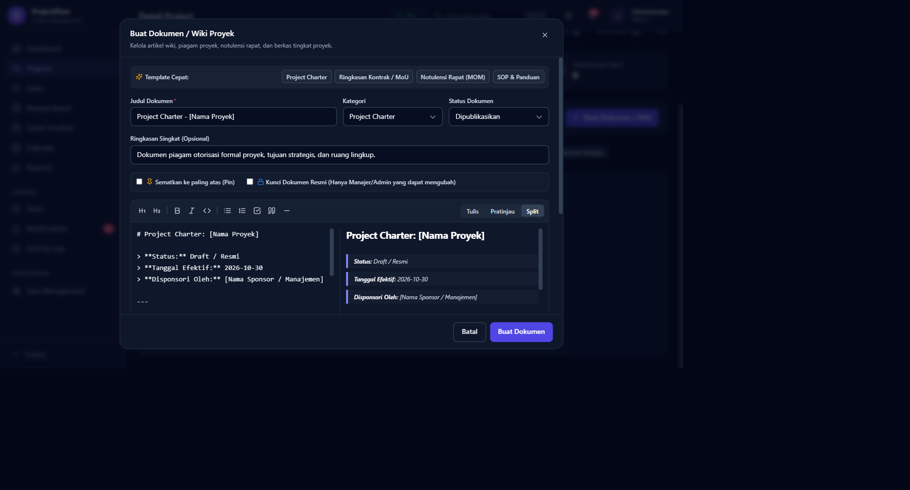
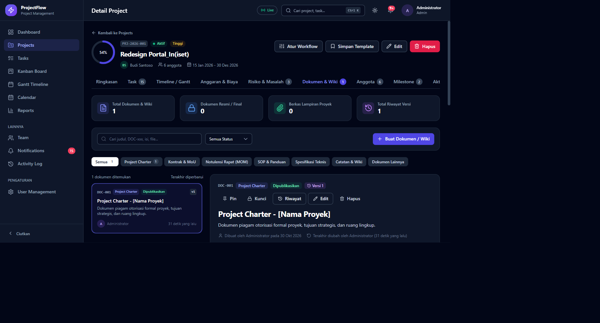
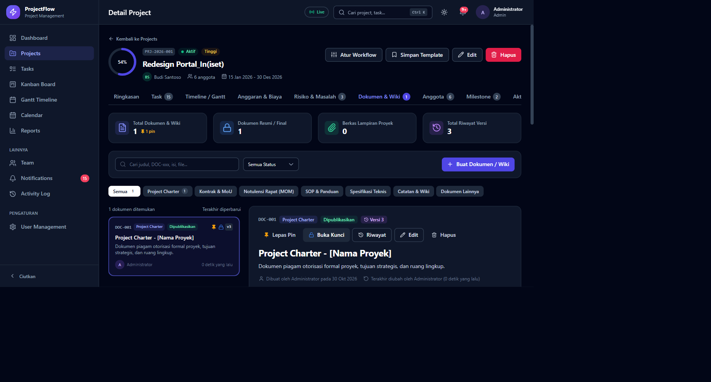
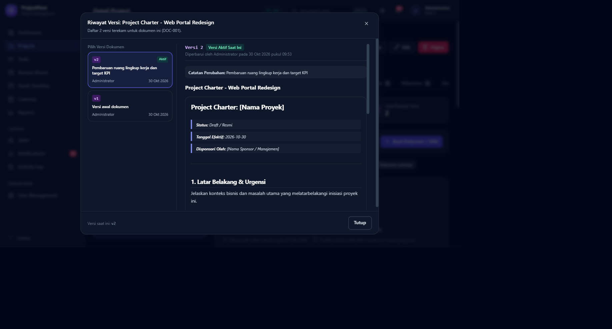
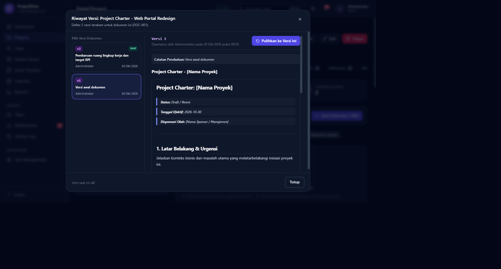
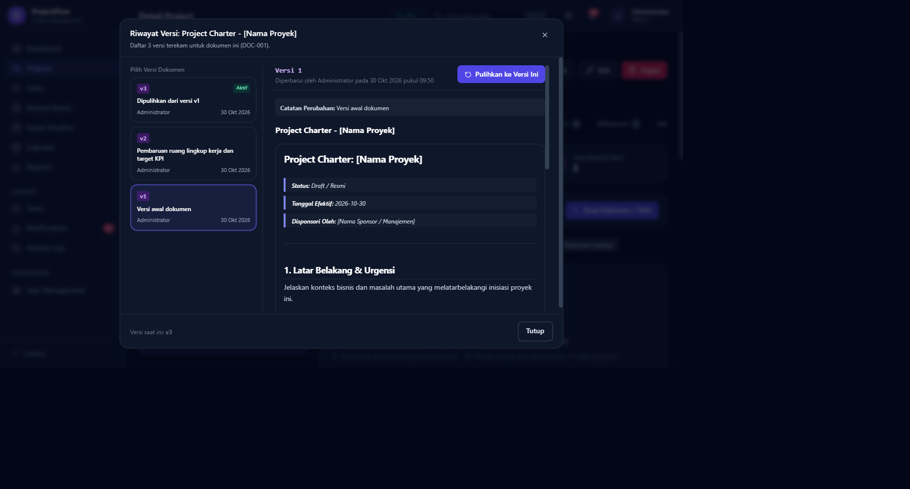

# Walkthrough: Manajemen Dokumen, Wiki Proyek, & Versioning (`project_documents`)

**Tanggal Pelaksanaan:** 30 Oktober 2026  
**Status:** ✅ Selesai & Terverifikasi Penuh (Backend & Frontend)

---

## 1. Ringkasan Eksekutif

Fitur **Manajemen Dokumen, Wiki Proyek, & Versioning** telah berhasil diimplementasikan secara menyeluruh untuk melengkapi sistem manajemen proyek. Sebelumnya, lampiran dan berkas hanya tersedia di tingkat task (`task_attachments`), tanpa adanya repositori terpusat di tingkat proyek.

Kini, pengguna dan tim proyek dapat:
1. Menyimpan dan mengelola dokumen tingkat proyek (Project Charter, Kontrak/MoU, Notulensi Rapat/MOM, SOP, Spesifikasi Teknis, dan Catatan Wiki).
2. Menggunakan **Hybrid Storage**: konten teks berbasis Markdown (Wiki) dan lampiran berkas fisik (PDF, DOCX, XLSX, Gambar, ZIP maks 10MB) dalam satu entitas dokumen.
3. Menulis dan meninjau dokumen dengan **Markdown Editor**: dilengkapi toolbar pemformatan lengkap, *Quick Templates*, serta mode *Tulis*, *Pratinjau*, dan *Live Split-View*.
4. Mengontrol **Versioning Penuh (Full Snapshot)**: setiap pembaruan konten atau berkas fisik secara otomatis membekukan versi lama dan mencatat riwayat versi (`v1`, `v2`, `v3`...) beserta nama kontributor, stempel waktu, dan catatan perubahan (*change note*).
5. Memulihkan versi terdahulu (*Restore*): mengembalikan snapshot versi lampau ke versi baru `v(N+1)` tanpa menghapus riwayat historis.
6. Mengatur proteksi dokumen: sematkan dokumen prioritas (*Pin*) dan kunci dokumen resmi (*Lock*) agar hanya dapat diedit oleh Project Manager / Owner / Administrator.

---

## 2. Rincian Perubahan Kode

### A. Database & Migrasi
- **`backend/src/database/schema.sql`**:
  - Tabel `project_documents`: menyimpan metadata dokumen (`project_id`, `code`, `title`, `category`, `status`, `summary`, `current_version`, `is_pinned`, `is_locked`, `created_by`, `updated_by`).
  - Tabel `project_document_versions`: menyimpan snapshot setiap versi (`document_id`, `version_number`, `title`, `content`, `change_note`, `file_name`, `file_original_name`, `file_mime_type`, `file_size`, `created_by`).
  - Menambahkan indeks optimasi pada `(project_id, is_pinned, updated_at)` dan `(document_id, version_number)`.
- **`backend/src/database/migrate.js`**:
  - Mendaftarkan tabel `project_documents` dan `project_document_versions` ke antrean migrasi otomatis.

### B. Backend (Model, Validator, Controller, Routes)
- **`backend/src/models/projectModel.js`**:
  - `generateDocumentCode(projectId)`: Menghasilkan kode unik `DOC-001`, `DOC-002`, dst. per proyek.
  - `listProjectDocuments(projectId, filters)`: Menampilkan daftar dokumen beserta info versi aktif dan pengunggah.
  - `getProjectDocumentSummary(projectId)`: Menghitung KPI ringkasan (total dokumen, dokumen final, berkas fisik, total riwayat versi, breakdown per kategori & status).
  - `findDocumentById(projectId, docId)`: Menampilkan detail dokumen tunggal beserta konten Markdown dan file lampiran aktif.
  - `listDocumentVersions(docId)`: Mengambil timeline riwayat semua versi dokumen.
  - `createProjectDocument(data, userId)`: Menyimpan dokumen awal dan merekam `v1` secara transaksional (`transaction`).
  - `updateProjectDocument(projectId, docId, data, userId)`: Memperbarui metadata dan membuat `v(N+1)` jika konten atau berkas mengalami perubahan.
  - `restoreDocumentVersion(projectId, docId, versionId, userId)`: Mengambil snapshot versi terdahulu dan menyimpannya sebagai versi baru `v(N+1)`.
  - `deleteProjectDocument(projectId, docId)`: Menghapus record dan membersihkan seluruh berkas fisik terkait di disk (`uploads/`).
  - `getProjectStats`: Menambahkan metrik `document_count`.
- **`backend/src/validators/project.validator.js`**:
  - Menambahkan skema validasi Joi untuk `documentCategory`, `documentStatus`, `createDocumentSchema`, `updateDocumentSchema`, dan `restoreDocumentVersionSchema`.
- **`backend/src/controllers/projectController.js`**:
  - Mengimplementasikan handler `listDocuments`, `getDocument`, `createDocument`, `updateDocument`, `restoreDocumentVersion`, dan `deleteDocument`.
  - Integrasi `@mention` notification: mendeteksi anggota yang di-mention dalam konten dokumen wiki dan mengirimkan notifikasi instan.
  - Integrasi Socket.IO real-time: memancarkan event `project:document_created`, `project:document_updated`, `project:document_deleted`.
  - Audit logging: merekam riwayat aksi ke tabel aktivitas melalui `activityService.record`.
- **`backend/src/routes/project.routes.js`**:
  - Mendaftarkan endpoint RESTful di bawah `/projects/:id/documents` dengan middleware `uploadSingle('file')` dari Multer.

### C. Frontend (UI/UX & Parser)
- **`frontend/src/utils/constants.js`**:
  - Menambahkan konstanta kategori dokumen (`charter`, `contract`, `mom`, `sop`, `technical`, `wiki`, `other`).
  - Menambahkan konstanta status dokumen (`draft`, `review`, `published`, `final`, `archived`).
  - Menambahkan 4 template cepat siap pakai: *Project Charter*, *Ringkasan Kontrak / MoU*, *Notulensi Rapat (MOM)*, dan *SOP & Panduan*.
- **`frontend/src/components/shared/CommentMarkdown.jsx`**:
  - Memperluas parser Markdown yang aman (tanpa `dangerouslySetInnerHTML`) untuk mendukung:
    - Headings H1 (`#`), H2 (`##`), H3 (`###`), H4 (`####`).
    - Blockquotes (`>`).
    - Numbered Lists (`1. Item`).
    - Checklists / To-do items (`- [ ]`, `- [x]`).
    - Horizontal Dividers (`---`).
    - Penanganan toleransi baris Windows (`\r\n` / CRLF normalization).
- **`frontend/src/api/project.api.js`**:
  - Menambahkan fungsi client API: `documents`, `getDocument`, `createDocument`, `updateDocument`, `restoreDocumentVersion`, `removeDocument`.
- **`frontend/src/components/shared/ProjectDocumentTab.jsx`**:
  - Komponen inti tab dengan 4 kartu KPI, filter kategori, kotak pencarian, dan layout Split-View (daftar dokumen di kiri, pembaca Markdown di kanan).
  - Modal editor dengan tab live preview split-view, toolbar Markdown cepat, dan form upload berkas fisik.
  - Modal riwayat versi (*VersionHistoryModal*) dengan visualisasi timeline, perbandingan teks/diff, tombol unduh file arsip, dan tombol pemulihan versi (*Restore*).
- **`frontend/src/pages/projects/ProjectDetail.jsx`**:
  - Menambahkan tab navigasi `Dokumen & Wiki` dengan penghitung jumlah dokumen aktif.
  - Menambahkan kartu ringkasan dokumen pada tab Ringkasan Proyek.

---

## 3. Hasil Verifikasi & Pengujian

### A. Pengujian Otomatis Backend (`verify-documents.js`)
Skrip pengujian integrasi otomatis `backend/scripts/verify-documents.js` dijalankan pada database MariaDB aktif:
1. `createProjectDocument`: Berhasil membuat dokumen DOC-001 dengan versi awal `v1`.
2. `getProjectDocument`: Memverifikasi pengambilan konten Markdown dan metadata `v1`.
3. `updateProjectDocument`: Memverifikasi pembuatan versi baru `v2` dengan catatan perubahan.
4. `restoreDocumentVersion`: Memulihkan versi `v1` menjadi `v3` dengan catatan pemulihan otomatis.
5. `getProjectDocumentSummary`: Memverifikasi kalkulasi KPI (total dokumen, versi, dan kategori).
6. `deleteProjectDocument`: Memverifikasi penghapusan cascade dan pembersihan berkas fisik.
*Hasil:* **100% Lulus (ALL BACKEND DOCUMENT TESTS PASSED SUCCESSFULLY! 🎉)**

### B. Pengujian End-to-End UI (Playwright)
Pengujian interaktif dilakukan secara langsung pada aplikasi yang berjalan (`http://localhost:5173/projects/1?tab=documents`):
1. **Navigasi & Tab Counter:** Tab "Dokumen & Wiki" tampil dengan jumlah dokumen yang sinkron.
2. **Template Cepat & Live Split Editor:** Memilih template "Project Charter" otomatis mengisi judul, kategori, summary, dan template Markdown. Mode split-view menampilkan preview Markdown secara real-time.
3. **Penyimpanan Dokumen (v1):** Dokumen berhasil disimpan dan langsung muncul pada kartu daftar dokumen serta Reader View di sebelah kanan.
4. **Rendering Markdown:** Seluruh elemen Markdown (H1, Blockquote, Divider, H2, List item, Bold) ter-render rapi dan konsisten dengan styling Tailwind CSS / Typography.
5. **Pembaruan Dokumen (v2):** Pengguna mengedit dokumen, mengubah judul, menambahkan catatan revisi versi, dan menyimpannya. Sistem memperbarui badge menjadi `Versi 2`.
6. **Timeline Riwayat Versi:** Membuka modal riwayat versi menampilkan timeline lengkap `v1` dan `v2` beserta pembuat, tanggal, dan catatan revisi.
7. **Pemulihan Versi (Restore to v3):** Memilih `v1` dan menekan "Pulihkan ke Versi Ini" berhasil menghasilkan versi `v3` ("Dipulihkan dari versi v1") tanpa mengubah integritas snapshot sebelumnya.
8. **Pin & Lock:** Menguji tombol `Pin` (menyematkan dokumen di urutan teratas) dan tombol `Kunci` (mencegah modifikasi oleh non-manajer) berjalan responsif.

---

## 4. Bukti Visual Hasil Pengujian

### 1. Editor Dokumen & Live Split Preview

### 2. Tampilan Pembaca Dokumen & Wiki (Reader View)

### 3. Dokumen Tersemat (Pinned) dan Terkunci (Locked)

### 4. Modal Riwayat Versi Dokumen (v1 & v2)

### 5. Inspeksi Versi Terdahulu & Tombol Pemulihan

### 6. Hasil Pemulihan Snapshot Versi (v3 Dibuat)

---

## 5. Kesimpulan & Status
Semua kebutuhan fitur **Manajemen Dokumen, Wiki Proyek, & Versioning** telah diimplementasikan dengan standar kode yang bersih, aman (proteksi XSS, validasi Joi, kontrol hak akses RBAC), serta didukung pengujian otomatis dan manual end-to-end yang solid.

